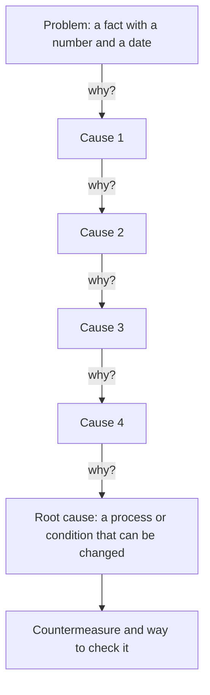

# 5 Whys

## Essence

"Five whys" is a method for finding the root cause of a problem. To an observed problem you ask "why did this happen?", to the answer you ask "why?" again, and so on, until you reach a cause the team can eliminate by changing a process. The number five is a guideline, not a rule.

## When to use and when not to

Use it after an incident, a failed metric or a recurring complaint, when the cause is not obvious and facts are accessible: logs, data extracts, the people involved in the events. The method works best on problems with one dominant chain of causes.

Inputs: the problem stated as a fact (what, where, when, at what scale), a timeline of events, and people or data that will confirm each answer.

Do not use it:

- when the problem has several independent causes (a sales drop under market pressure, a cascading failure): a linear chain will pull out one cause and hide the others;
- when there are no facts and the answers become guesses — collect the data first;
- in an atmosphere of looking for someone to blame: the chain will stop at "the person made a mistake", and nothing will change.

## Scheme

If a question has several confirmed answers, the chain branches into a tree, and each branch is followed to its own root.

## How to apply

1. **State the problem as a fact.** Not "bad payments", but "on March 12, 3.1% of card payments failed against a normal 0.4%".
2. **Gather the participants.** You need people who know the process from the inside, and a facilitator who keeps to the facts and does not allow a search for blame. The session takes 30–60 minutes.
3. **Ask "why did this happen?".** Record only the answer confirmed by data. Mark an unconfirmed answer as a hypothesis and check it before moving on.
4. **Repeat the question for each answer.** Check the link: read the chain bottom-up with the word "therefore" — each link must lead to the previous one.
5. **Stop at a cause the team can change** (a rule, a process, a working condition) whose elimination would prevent the problem. This may happen at the third step or at the seventh.
6. **Separate the branches.** If several confirmed causes exist at one level, follow each one separately.
7. **Record the result:** root cause, countermeasure (what changes, who is responsible, by when) and the way to check — a metric or event.

Interpretation: if the countermeasure sounds like "be more careful" or "punish the person responsible", the root has not been found — ask "why?" once more.

## Example

Amazon, a fulfillment center (a warehouse that picks and ships customer orders), 2004. An employee injured a finger on a conveyor. Jeff Bezos at a meeting analyzed the case at a whiteboard — this is how Peter Abilla, who worked at the Amazon warehouse at the time, describes it:

1. Why was the employee's finger injured? — The finger was caught in the conveyor.
2. Why was the finger caught? — The employee tried to get his bag off a running belt.
3. Why was the bag on the running belt? — He put it on the conveyor, and the conveyor unexpectedly started.
4. Why was the bag lying on the conveyor? — The employee used the conveyor as a table.

Root cause: there was no surface at the workplace for belongings, and the employee improvised. Solution: put tables in the needed areas, issue light portable tables, or set aside space on the floor for bags. The chain took four steps, not five, and at no step was the answer "the employee is to blame".

Source of the case: [Peter Abilla — Watch Jeff Bezos Use the 5 Whys Technique](https://www.linkedin.com/pulse/use-5-whys-find-root-causes-peter-abilla).

## Common mistakes

- **Stopping at a symptom or at a person.** "The operator made a mistake" is not a root. Ask why the process allowed the mistake.
- **Guess answers.** One unverified hypothesis steers the whole chain off course, and the countermeasure treats a cause that does not exist.
- **One chain where there are several causes.** The method tends to find a single cause, and different people looking at the same facts arrive at different roots. Check the chain against data and hold the session with participants in different roles.
- **Mechanically counting to five.** The fifth step is not obliged to match the root: you may stop too early and miss the cause, or go further and lose the lever.
- **Going beyond the team's influence.** The answer "because that is how the market works" gives nothing — stop at the level where the team has a lever.
- **A countermeasure without a check.** Without a metric and a deadline it is unknown whether the root was eliminated.

## Source

The method was devised by Sakichi Toyoda, founder of the company from which Toyota grew. It was popularized by Taiichi Ohno, the architect of the Toyota production system, in the book "Toyota Production System: Beyond Large-Scale Production" (English edition — 1988). Ohno called the five-fold "why" the basis of Toyota's scientific approach. Criticism of the method — stopping at symptoms, low reproducibility, a tendency toward a single cause — is summarized in the [Five whys article on Wikipedia](https://en.wikipedia.org/wiki/Five_whys).

## See also

- Enhanced by Retrospective Meeting: Take the problem the retrospective names as costliest and run 5 Whys on it.
- Preceded by Feedback Matrix: Find a recurring critique in the feedback matrix, then run 5 Whys on it.
